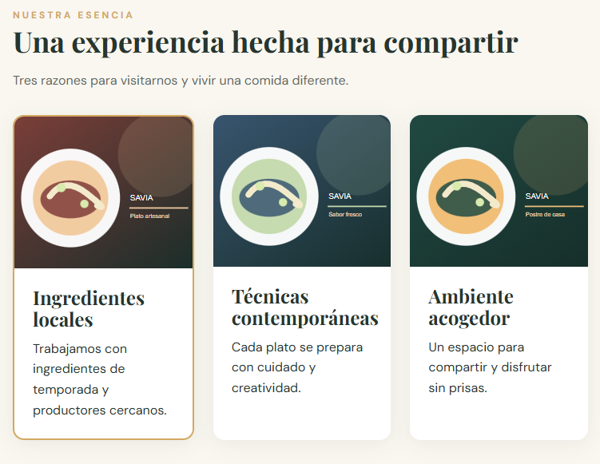
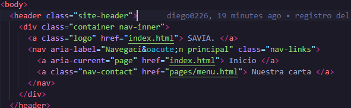
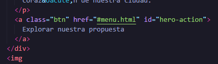
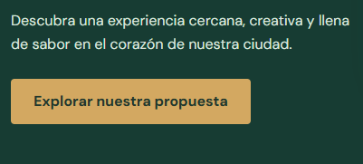
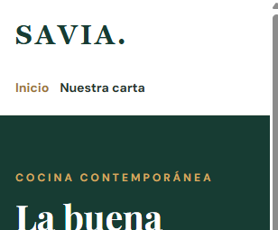

# SAVIA — examen N.º 1

Proyecto estático HTML + CSS. Abrir `index.html` en el navegador. No necesita dependencias.

El sitio incluye la página Inicio y las plantillas `pages/menu.html`, `pages/equipo.html` y `pages/eventos.html` con contenido central pendiente. Siga exclusivamente las especificaciones del examen para conocer el comportamiento esperado. No modifique el tema general ni sustituya el proyecto por otro.

## Diagnóstico de cinco incidencias

| N.º | Comportamiento observado | Causa técnica y ubicación | Corrección realizada | Prueba de verificación | Autor |
|---|---|---|---|---|---|
| 1 |Las imagenes se veian una debajo de la otra |En el archivo styles la parte feature-layout linea 123 Flex diretion se encontraba "column" | Se cambio flex direction a "row" | | Rafael Porras Rakow |
| 2 | Al seleccionar nuestra carta llevaba a la pagina eventos | En index.html, header, en la línea 15 El href tenía mal escrito la dirección| Se cambio el href para que dirija a menu.html |  | Rafael Porras Rakow |
| 3 | Usar el boton de "Explorar nuestra propuesta" dirijia al hero | se encontraba en index.html en el section class hero en la línea 30 El id estaba mal puesto, ya que usaba el de hero | Se cambio el href por el de menu.html |  | Rafael Porras Rakow |
| 4 | El botón explorar nuestra propuesta era rojo | En styles.css, el hero action en la linea 245 estaba el color rojo | En la línea 245 se cambio al color dorado |  | Diego Zamora Arce |
| 5 | A la hora de ponerlo en pantalla de 375 px la navegación no bajaba |En el styles en la linea 249 el flex-direction estaba en row |En el styless en la linea 249 poner el flex-direction como column. |  |Diego Zamora Arce |

## Responsables de las funcionalidades

| Estudiante | Página asignada | Rama | Commits principales |
|---|---|---|---|
| | | | |

## Evidencias Git

| Funcionalidad/corrección | PR hacia develop | Revisor | Resultado de merge / conflicto si ocurrió |
|---|---|---|---|
| | | | |

## Verificación final
Registrar las pruebas de funcionamiento a 1280 px y 375 px, enlaces y páginas.
